<div align="center">

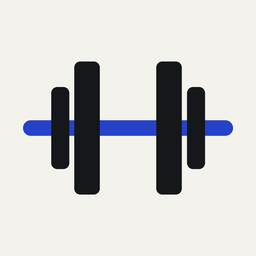

# FORGE

**An adaptive strength coach for iPhone and Apple Watch, powered by on-device AI.**

FORGE plans each session from your recovery, schedule, equipment and feedback,<br>
sets a weight target for every lift, and saves every workout to Apple Health.


-FF6B2C)


</div>

<p align="center">
  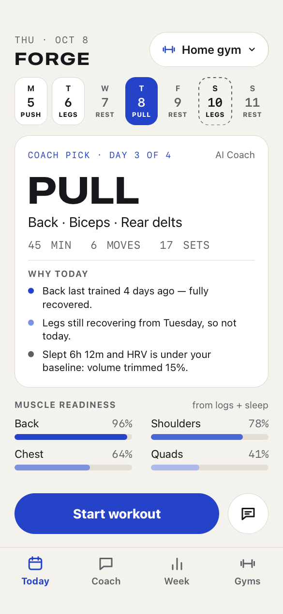
  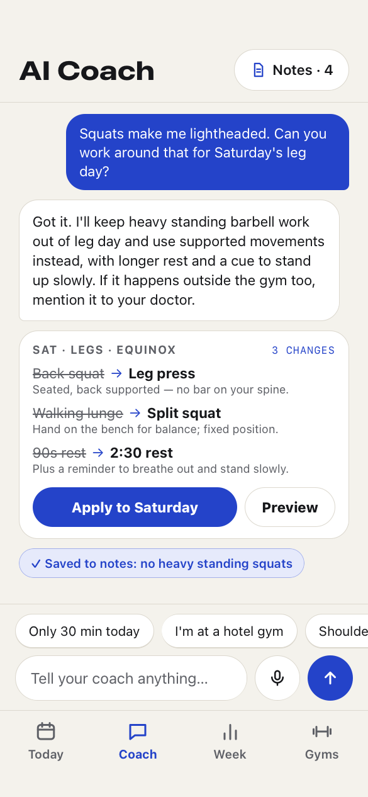
  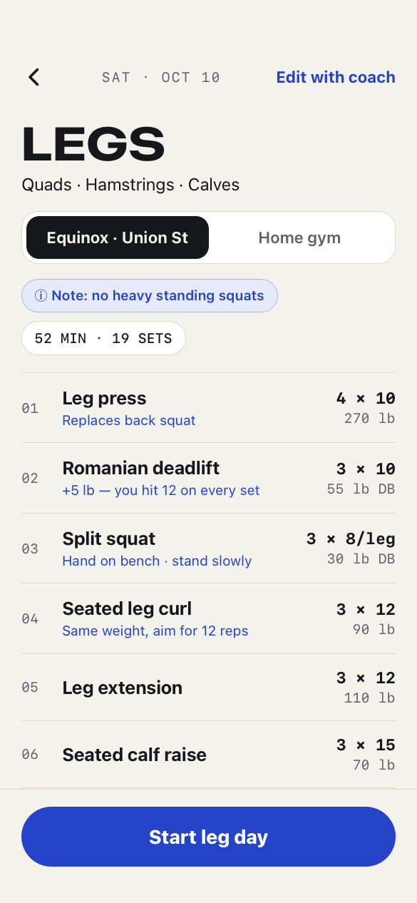
  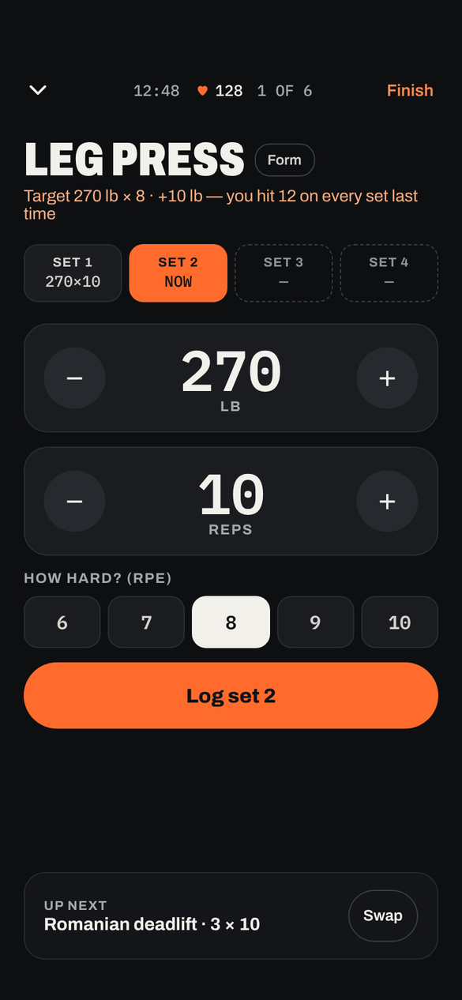
  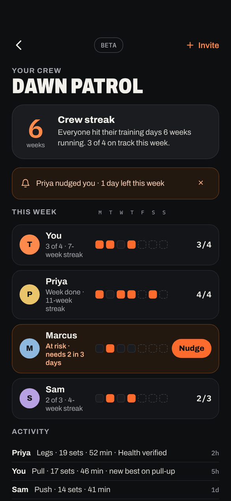
</p>

<p align="center"><sub>Design mockups. The SwiftUI app follows the same layout and theme.</sub></p>

---

## Contents

- [Highlights](#highlights)
- [How the AI Coach works](#how-the-ai-coach-works)
- [Architecture](#architecture)
- [Getting started](#getting-started)
- [Testing](#testing)
- [Privacy](#privacy)
- [Project layout](#project-layout)
- [Roadmap](#roadmap)

## Highlights

| | |
|---|---|
| **AI Coach, on device** | Picks today's session from muscle readiness, your split and training days. Built on Apple's Foundation Models framework with guided generation and tool calling. Runs privately on the iPhone; a rule-based coach takes over when Apple Intelligence is off. |
| **Learns your limits** | Tell it *"squats make me lightheaded"* and it saves a note, rules out bar-on-spine and heavy standing lifts, swaps in supported movements, lengthens rest and adds a "stand up slowly" cue. A note about one lift stays about that lift: *"I can't do a pull-up yet"* swaps in band-assisted and negative pull-ups and leaves the rest of your back day alone. |
| **Chat that feels alive** | Coach replies stream in word by word, with rotating status lines (*"running up the steps…"*, *"crunching the abs…"*) while it thinks or rebuilds a plan. |
| **Equipment-aware** | Gym profiles (home, commercial, travel). The coach only programs what that gym has, so a leg press becomes bench step-ups at home. |
| **Finds your weights** | The first time you do a weighted lift, test sets climb until one feels like an RPE 8 (e.g. 135 lb × 5). That gives an estimated max, and your goal turns it into working weights: heavy triples to get stronger, 6–10 reps to build muscle, heavy-but-short-rest to lose fat. |
| **Progressive overload** | Double progression gives each lift a weight + rep target inside your goal's rep range. Your RPE and the "how did it feel" check-in after each workout nudge load and volume up or down. Change your goal and the weights are reworked from your estimated max. |
| **Plans the week** | Every upcoming training day gets a plan that accounts for the days before it. Ask the coach to *"make Saturday shorter"* and only Saturday is rebuilt. Tap any date in the week strip to see that day's plan in Today, then move it to another day, make it a rest day, or add a training day. |
| **Exercise library** | 138 curated exercises: the major lifts plus warm-ups, mobility drills, stretches and posture work. Each has a movement pattern, a level, and start/finish photos where available. |
| **Form guides** | One page per exercise, written for beginners: start/finish photos, what it works, what you need, how many, one key cue to remember, then numbered steps and what to avoid. |
| **Warm-up built in** | Every workout opens with a warm-up matched to the day's lifts, plus lighter ramp-up sets for the first big lift, and ends with an optional cool-down. On by default; skip it any time. |
| **Apple Health + Fitness** | Workouts run as real `HKWorkoutSession`s with live heart rate and calories. Each set is saved as a workout segment, and finished workouts appear in Fitness. |
| **Apple Watch** | Today's plan on the wrist (sent straight from the iPhone, no iCloud needed), Digital Crown set logging, rest timer and live heart rate. |
| **One shared workout** | Start on either device and the Watch runs the workout while the iPhone mirrors it. Sets and rest timers stay in step on both screens, and Health gets exactly one workout. |
| **Live Activity** | The rest countdown runs on the Lock Screen and in the Dynamic Island, with **Skip** and **+30 s** buttons. |
| **History** | Weekly volume, week streaks, every past workout, and an estimated 1-rep max chart for each lift. |
| **Crews (beta)** | Weekly streaks with friends over CloudKit sharing. No server. Crews see check-ins only. |
| **Siri + Shortcuts** | *"What's today's workout in FORGE"* · *"Log a set in FORGE"* |
| **Syncs everywhere** | SwiftData + CloudKit across iPhone, iPad and Watch. Settings sync through iCloud key-value storage. |

<details>
<summary><b>More screens</b></summary>
<br>
<p align="center">
  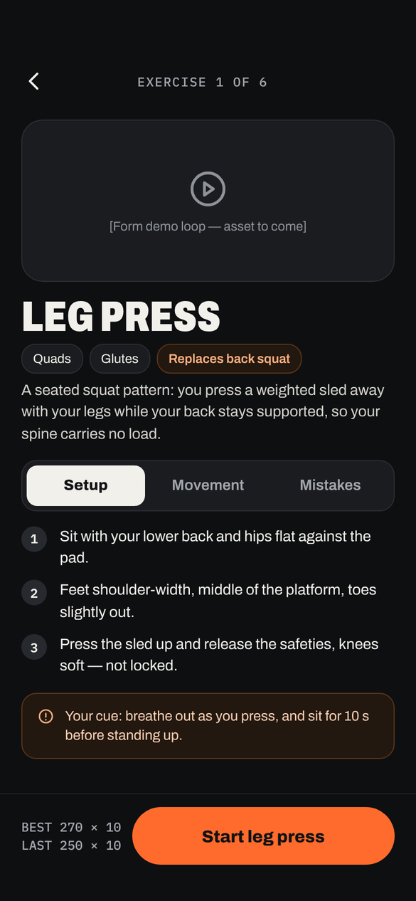
  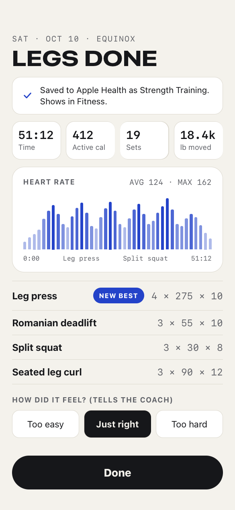
  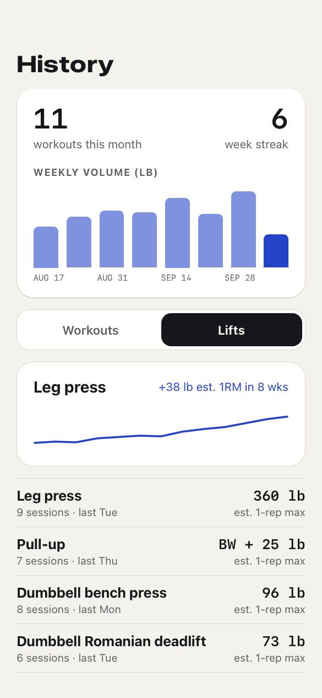
  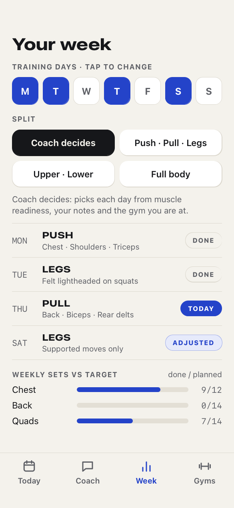
</p>
<p align="center">
  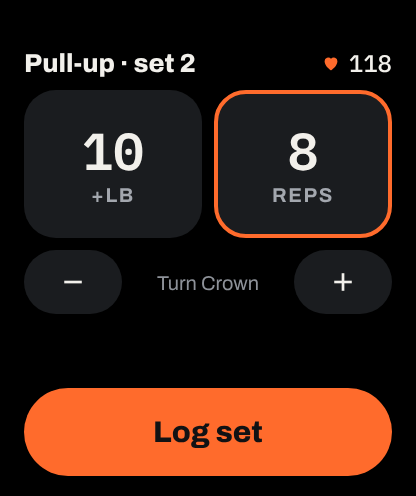
</p>
</details>

## How the AI Coach works

The model never chooses freely from every exercise. It only works within options the app has already checked.

1. **Context.** `CoachStore` builds a `CoachContext` with muscle readiness (from logged sets, about 72 h to recover), the week so far, sleep and HRV from HealthKit, the active gym's equipment, coach notes, recent RPE and how your last sessions felt.
2. **Generate.** `AppleIntelligenceCoach` opens a `LanguageModelSession` and asks for a `@Generable GeneratedDayPlan`. The model calls the `findExercises(muscle:)` tool, which only returns exercises the gym supports and no note rules out.
3. **Finish.** Every plan, AI or rule-based, goes through `PlanFinisher`. It validates names against the catalog, clamps sets to your experience level, eases or pushes volume based on feedback, adds "replaces back squat" labels, and attaches a `Progression` weight target to each lift.
4. **Chat.** Messages return a `@Generable GeneratedReply`, streamed with `streamResponse` so the message appears as it's written. It decides whether the message is lasting feedback, which specific exercises and which `MovementFlag`s to avoid, which day it applies to, and whether to rebuild.
5. **Check the note.** The model's choices aren't trusted blindly. `NoteSnapshot.checked()` keeps a movement flag only if the athlete's words point to it, and keeps exercise limits only when they're phrased negatively. `PlanFinisher` drops a cue the model copied onto three or more exercises. Notes saved before these checks are repaired at launch.

## Architecture

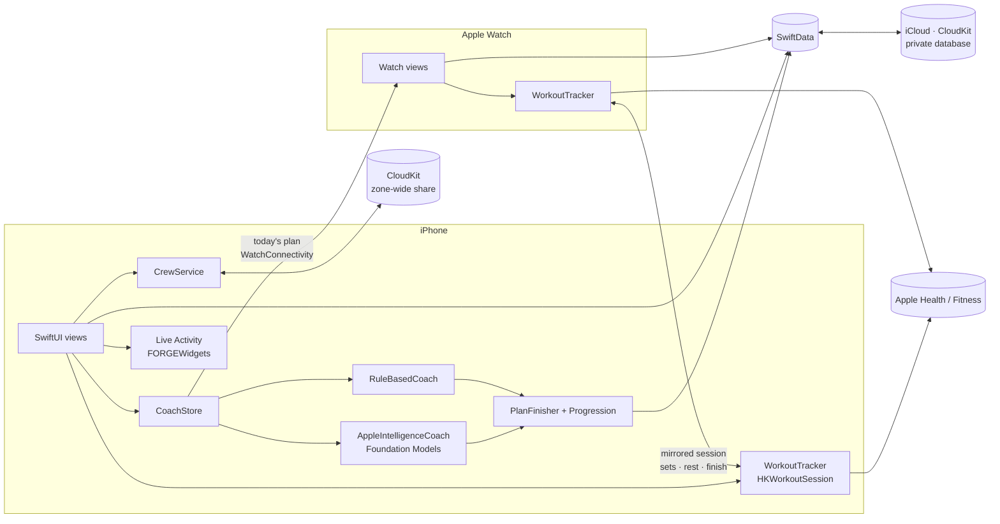

| Layer | Technology |
|---|---|
| UI | SwiftUI, Swift Charts, App Intents |
| AI | Foundation Models (guided generation, tool calling), rule-based fallback |
| Data | SwiftData with CloudKit private database, `NSUbiquitousKeyValueStore` |
| Health | HealthKit: `HKWorkoutSession`, `HKLiveWorkoutBuilder`, workout mirroring, sleep and HRV queries |
| Watch link | WatchConnectivity (plan + units), HealthKit mirrored sessions (live workout) |
| Live Activity | ActivityKit, WidgetKit, `LiveActivityIntent` buttons |
| Social | CloudKit zone-wide `CKShare`, zone/database subscriptions |
| Tests | Swift Testing |

## Getting started

### Requirements

- Xcode 26 or later
- iPhone with iOS 26+. The AI Coach needs an Apple Intelligence-capable device with Apple Intelligence turned on.
- Apple Watch with watchOS 26+ (optional)
- An Apple Developer account for iCloud sync, Crews and push. A free account works too, with the `FORGE Personal` scheme: everything except sync and Crews.
- [XcodeGen](https://github.com/yonaskolb/XcodeGen)

### Build

```sh
brew install xcodegen
git clone https://github.com/tajshaik24/forge.git
cd forge
xcodegen            # generates FORGE.xcodeproj from project.yml
open FORGE.xcodeproj
```

Then in Xcode:

1. Set your **Team** on the `FORGE`, `FORGEWatch` and `FORGETests` targets.
2. If `com.taj.forge` isn't available to your team, change the bundle IDs in `project.yml`, and the iCloud container in the two `.entitlements` files and `Shared/Persistence.swift` (`DataStore.cloudContainerID`). Then run `xcodegen` again.
3. Run the `FORGE` scheme on a device (or `FORGE Personal` on a free team). HealthKit workouts and the AI Coach don't fully work in the Simulator.

For the full device walkthrough (signing, iCloud container, Developer Mode, Apple Watch deploys, troubleshooting), see [docs/running-on-device.md](docs/running-on-device.md).

### Crews (beta)

Turn on **Settings → Crews (beta)**. Crews run on CloudKit, so the first crew you create in a Debug build adds the `Crew`, `Member`, `CheckIn` and `Nudge` record types to your container's development schema. Before shipping to TestFlight, deploy that schema to production in the [CloudKit Console](https://icloud.developer.apple.com/). Test invite links on real devices with different Apple Accounts.

> [!NOTE]
> The Xcode project is generated, so `*.xcodeproj` is git-ignored. Change targets and Info.plist keys in `project.yml`, and entitlements in the checked-in `*.entitlements` files. On a free Apple team, run the `FORGE Personal` scheme (see [docs/running-on-device.md](docs/running-on-device.md#without-a-paid-account)).

### Regenerating the app icon

```sh
python3 tools/make_icon.py FORGE/Assets.xcassets/AppIcon.appiconset FORGEWatch/Assets.xcassets/AppIcon.appiconset
```

### Updating exercise photos

```sh
python3 tools/import_exercise_photos.py   # fetches start/finish photos for every `photo:` in the catalog
```

## Testing

```sh
xcodebuild test -scheme FORGE -destination 'platform=iOS Simulator,name=iPhone 17'
```

68 tests in 11 suites (Swift Testing):

| File | Covers |
|---|---|
| `CoachLogicTests.swift` | progressive overload, rep-range parsing, units, day matching, readiness, plan finishing (equipment, notes, experience, feedback), crew streaks |
| `CoachNoteTests.swift` | notes stay specific: flag checks, exercise matching, easier versions, copied cues, every exercise has a form guide |
| `MoveDayTests.swift` | moving and swapping days, rest days, adding a training day |
| `MirrorTests.swift` | Watch ↔ iPhone message coding |
| `StrengthTests.swift` | estimated max, goal rep ranges, test-set climbing, working weights after a test or a goal change |
| `LibraryTests.swift` | library integrity (guides, cues, patterns, bundled photos), planner levels, warm-up and cool-down picks, ramp-up sets, old plans still decode |

Mirroring, the Live Activity and Health writes need real hardware. See the checklists in [docs/scope-device-watch-live.md](docs/scope-device-watch-live.md).

## Privacy

- **The AI runs on device.** Prompts, plans and chat go to Apple's on-device model, not a server.
- **Your data stays in your iCloud.** Workouts, notes and chat sync through your private CloudKit database. FORGE has no backend.
- **Health data stays local.** Sleep and HRV are read on the iPhone to shape the plan and are never uploaded or shared.
- **Crews share check-ins only:** workout type, sets, minutes, and whether Health recorded it. Weights, heart rate, sleep and coach notes are never shared.

## Project layout

```
FORGE/            iPhone app
  App/            entry point, app + scene delegates
  Coach/          CoachEngine, AppleIntelligenceCoach, RuleBasedCoach, CoachStore
  Crew/           CloudKit sharing, streak math, Crew UI (beta)
  Activity/       Live Activity attributes, Skip / +30 s intents, controller
  Health/         sleep + HRV snapshot
  Intents/        Siri / Shortcuts
  Views/          Today, Plan, Active workout, Summary, History, Week, Gyms, day actions, Settings…
  Resources/      exercise photos (free-exercise-db, public domain)
  Workout/        rest notifications
FORGEWatch/       Apple Watch app
FORGEWidgets/     Live Activity / Dynamic Island (widget extension)
Shared/           code built into both apps: models, catalog, form guides,
                  progression, HealthKit workout tracker + mirroring,
                  Watch link, theme
FORGETests/       Swift Testing suite
docs/             icon, screenshots, device guide, scope docs, gameplan
tools/            icon generator, exercise photo importer
project.yml       XcodeGen spec
```

## Roadmap

What's next, and why, is in [docs/gameplan.md](docs/gameplan.md).

- [x] AI Coach with equipment- and notes-aware planning
- [x] Progressive overload, RPE and how-it-felt feedback
- [x] HealthKit workouts, Apple Watch logging, iCloud sync
- [x] History, custom exercises, onboarding, lb/kg
- [x] Crews (beta): weekly streaks and nudges over CloudKit
- [x] Compile fixes, free-team `Personal` build, first run on a physical iPhone
- [x] Watch ↔ iPhone workout mirroring (one shared live workout)
- [x] Live Activity / Dynamic Island rest timer
- [x] Streaming coach chat, exercise-scoped notes, easier pull-up versions
- [x] One-page form guides, tappable week strip, move / rest / train any day
- [ ] Verify mirroring, streaming and the Live Activity on iPhone + Watch
- [x] Exercise library v2: 138 exercises with patterns, levels, photos, warm-ups, stretches and posture work
- [x] Warm-up, ramp-up sets and cool-down in every workout
- [x] "Find your weight" test sets and goal-based rep ranges, rest and working weights
- [ ] Program builder the AI fills in: weekly volume, 4-week blocks with a deload, pinned days
- [ ] Guided intake: body check, pull-up/push-up checks, priorities, tight spots
- [ ] Widgets and Watch complication (after the App Group check)
- [ ] Animated form demos
- [ ] "Scan this gym" from photos (multimodal Foundation Models, iOS 27)
- [ ] Crew challenges and per-crew leaderboards

## Known limitations

- Mirroring, streaming chat and the Live Activity are built and unit-tested, but not yet checked on a real iPhone + Watch.
- Changing settings or saving a coach note re-plans the week, which undoes days you moved by hand.
- The Live Activity runs only while the workout screen is open on the iPhone. A workout started on the Watch shows it once you open it from the Today card.
- The assisted pull-up machine isn't in the catalog yet: its weight is assistance, so progression would have to run backwards.
- Two devices logging at the same moment, before iCloud syncs, can create two sessions for that day.
- Anyone with a crew's invite link can join, which is fine for the beta.
