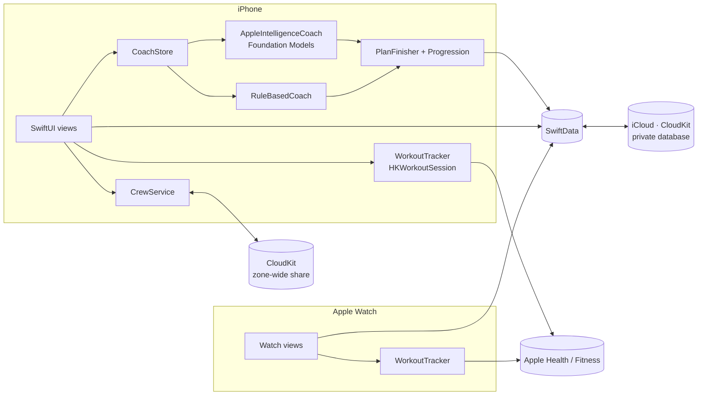

<div align="center">


# FORGE

**An adaptive strength coach for iPhone and Apple Watch, powered by on-device AI.**

FORGE plans each session from your recovery, schedule, equipment and feedback,<br>
sets a weight target for every lift, and saves every workout to Apple Health.


-FF6B2C)


</div>

<p align="center">
  
  
  
  
  
</p>

<p align="center"><sub>Design mockups. The SwiftUI app follows the same layout and theme.</sub></p>

---

## Contents

- [Highlights](#highlights)
- [How the AI Coach works](#how-the-ai-coach-works)
- [Architecture](#architecture)
- [Getting started](#getting-started)
- [Testing](#testing)
- [Privacy](#privacy)
- [Project layout](#project-layout)
- [Roadmap](#roadmap)

## Highlights

| | |
|---|---|
| **AI Coach, on device** | Picks today's session from muscle readiness, your split and training days. Built on Apple's Foundation Models framework with guided generation and tool calling. Runs privately on the iPhone; a rule-based coach takes over when Apple Intelligence is off. |
| **Learns your limits** | Tell it *"squats make me lightheaded"* and it saves a note, rules out bar-on-spine and heavy standing lifts, swaps in supported movements, lengthens rest and adds a "stand up slowly" cue. |
| **Equipment-aware** | Gym profiles (home, commercial, travel). The coach only programs what that gym has, so a leg press becomes bench step-ups at home. |
| **Progressive overload** | Double progression gives each lift a weight + rep target. Your RPE and the "how did it feel" check-in after each workout nudge load and volume up or down. |
| **Plans the week** | Every upcoming training day gets a plan that accounts for the days before it. Ask the coach to *"make Saturday shorter"* and only Saturday is rebuilt. |
| **Form guides** | Every exercise has a description, setup and movement steps, and common mistakes. |
| **Apple Health + Fitness** | Workouts run as real `HKWorkoutSession`s with live heart rate and calories. Each set is saved as a workout segment, and finished workouts appear in Fitness. |
| **Apple Watch** | Today's plan on the wrist, Digital Crown set logging, rest timer and live heart rate. |
| **History** | Weekly volume, week streaks, every past workout, and an estimated 1-rep max chart for each lift. |
| **Crews (beta)** | Weekly streaks with friends over CloudKit sharing. No server. Crews see check-ins only. |
| **Siri + Shortcuts** | *"What's today's workout in FORGE"* · *"Log a set in FORGE"* |
| **Syncs everywhere** | SwiftData + CloudKit across iPhone, iPad and Watch. Settings sync through iCloud key-value storage. |

<details>
<summary><b>More screens</b></summary>
<br>
<p align="center">
  
  
  
  
</p>
<p align="center">
  
</p>
</details>

## How the AI Coach works

The model never chooses freely from every exercise. It only works within options the app has already checked.

1. **Context.** `CoachStore` builds a `CoachContext` with muscle readiness (from logged sets, about 72 h to recover), the week so far, sleep and HRV from HealthKit, the active gym's equipment, coach notes, recent RPE and how your last sessions felt.
2. **Generate.** `AppleIntelligenceCoach` opens a `LanguageModelSession` and asks for a `@Generable GeneratedDayPlan`. The model calls the `findExercises(muscle:)` tool, which only returns exercises the gym supports and no note rules out.
3. **Finish.** Every plan, AI or rule-based, goes through `PlanFinisher`. It validates names against the catalog, clamps sets to your experience level, eases or pushes volume based on feedback, adds "replaces back squat" labels, and attaches a `Progression` weight target to each lift.
4. **Chat.** Messages return a `@Generable GeneratedReply`. It decides whether the message is lasting feedback, which `MovementFlag`s to avoid, which day it applies to, and whether to rebuild.

## Architecture



| Layer | Technology |
|---|---|
| UI | SwiftUI, Swift Charts, App Intents |
| AI | Foundation Models (guided generation, tool calling), rule-based fallback |
| Data | SwiftData with CloudKit private database, `NSUbiquitousKeyValueStore` |
| Health | HealthKit: `HKWorkoutSession`, `HKLiveWorkoutBuilder`, sleep and HRV queries |
| Social | CloudKit zone-wide `CKShare`, zone/database subscriptions |
| Tests | Swift Testing |

## Getting started

### Requirements

- Xcode 26 or later
- iPhone with iOS 26+. The AI Coach needs an Apple Intelligence-capable device with Apple Intelligence turned on.
- Apple Watch with watchOS 26+ (optional)
- An Apple Developer account, for HealthKit, iCloud and push entitlements
- [XcodeGen](https://github.com/yonaskolb/XcodeGen)

### Build

```sh
brew install xcodegen
git clone https://github.com/tajshaik24/forge.git
cd forge
xcodegen            # generates FORGE.xcodeproj from project.yml
open FORGE.xcodeproj
```

Then in Xcode:

1. Set your **Team** on the `FORGE`, `FORGEWatch` and `FORGETests` targets.
2. If `com.taj.forge` isn't available to your team, change the bundle IDs in `project.yml`, and the iCloud container in both `project.yml` and `Shared/Persistence.swift` (`DataStore.cloudContainerID`). Then run `xcodegen` again.
3. Run the `FORGE` scheme on a device. HealthKit workouts and the AI Coach don't fully work in the Simulator.

### Crews (beta)

Turn on **Settings → Crews (beta)**. Crews run on CloudKit, so the first crew you create in a Debug build adds the `Crew`, `Member`, `CheckIn` and `Nudge` record types to your container's development schema. Before shipping to TestFlight, deploy that schema to production in the [CloudKit Console](https://icloud.developer.apple.com/). Test invite links on real devices with different Apple Accounts.

> [!NOTE]
> The Xcode project is generated, so `*.xcodeproj` is git-ignored. Change targets, entitlements and Info.plist keys in `project.yml`.

### Regenerating the app icon

```sh
python3 tools/make_icon.py FORGE/Assets.xcassets/AppIcon.appiconset FORGEWatch/Assets.xcassets/AppIcon.appiconset
```

## Testing

```sh
xcodebuild test -scheme FORGE -destination 'platform=iOS Simulator,name=iPhone 17'
```

The tests in `FORGETests/CoachLogicTests.swift` cover progressive overload, rep-range parsing, units, day matching, readiness, plan finishing (equipment, notes, experience, feedback) and crew streaks.

## Privacy

- **The AI runs on device.** Prompts, plans and chat go to Apple's on-device model, not a server.
- **Your data stays in your iCloud.** Workouts, notes and chat sync through your private CloudKit database. FORGE has no backend.
- **Health data stays local.** Sleep and HRV are read on the iPhone to shape the plan and are never uploaded or shared.
- **Crews share check-ins only:** workout type, sets, minutes, and whether Health recorded it. Weights, heart rate, sleep and coach notes are never shared.

## Project layout

```
FORGE/            iPhone app
  App/            entry point, app + scene delegates
  Coach/          CoachEngine, AppleIntelligenceCoach, RuleBasedCoach, CoachStore
  Crew/           CloudKit sharing, streak math, Crew UI (beta)
  Health/         sleep + HRV snapshot
  Intents/        Siri / Shortcuts
  Views/          Today, Plan, Active workout, Summary, History, Week, Gyms, Settings…
  Workout/        rest notifications
FORGEWatch/       Apple Watch app
Shared/           code built into both apps: models, catalog, form guides,
                  progression, HealthKit workout tracker, theme
FORGETests/       Swift Testing suite
docs/             icon + screenshots
tools/            icon generator
project.yml       XcodeGen spec
```

## Roadmap

- [x] AI Coach with equipment- and notes-aware planning
- [x] Progressive overload, RPE and how-it-felt feedback
- [x] HealthKit workouts, Apple Watch logging, iCloud sync
- [x] History, custom exercises, onboarding, lb/kg
- [x] Crews (beta): weekly streaks and nudges over CloudKit
- [ ] First device build and compile fixes
- [ ] Watch ↔ iPhone workout mirroring (one shared live workout)
- [ ] Live Activity / Dynamic Island rest timer, widgets, Watch complication
- [ ] "Scan this gym" from photos (multimodal Foundation Models, iOS 27)
- [ ] Form demo videos
- [ ] Crew challenges and per-crew leaderboards

## Known limitations

- The project has not been compiled yet, so expect a round of compiler fixes on the first build.
- Starting a workout on both the Watch and the iPhone records two workouts in Health until mirroring lands.
- Two devices logging at the same moment, before iCloud syncs, can create two sessions for that day.
- Anyone with a crew's invite link can join, which is fine for the beta.
