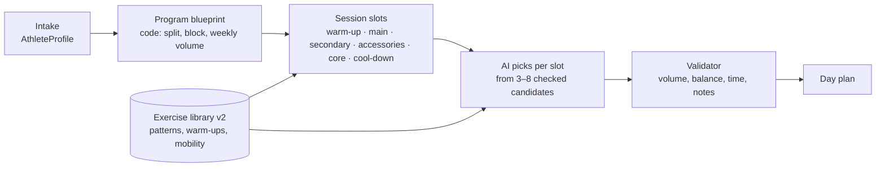

# Gameplan: what's next

Written 2026-10-14, updated the same day: phases 1 and 2 are built. This doc covers what we build next, in what order, and why. Status of the device, Watch and Live Activity work is in [scope-device-watch-live.md](scope-device-watch-live.md).

## Where we are

Shipped in code: free-team device build, Watch ↔ iPhone mirroring, Live Activity rest timer, streaming coach chat, exercise-scoped notes, one-page form guides, a tappable week strip with move / rest / train. 43 tests pass.

The weak spot is **how plans are made**. Today the coach builds each day on its own:

- It picks a focus (Push, Pull, …) from readiness, then asks the on-device model for 4–7 exercises out of a 47-exercise catalog.
- Nothing tracks **weekly volume per muscle**, **movement balance** (push vs. pull, squat vs. hinge), or **progress over a block** of weeks.
- There's **no warm-up, mobility or cool-down**. The catalog has strength lifts only.
- Onboarding asks for goal, experience, days, minutes and gym. It doesn't ask about injuries, priorities, likes and dislikes, or mobility.
- Any settings or note change re-plans the whole week and undoes days you moved by hand.

The on-device model is small (about 3B parameters, with a short context window). It's good at choosing from a short list and writing a sentence. It's bad at holding a whole training program in its head. So the plan below gives it **less to decide, with better options**.

## The idea: code builds the skeleton, the AI fills the slots

1. **Intake → `AthleteProfile`.** One place that holds everything the coach should know about you.
2. **Blueprint (code, deterministic).** From the split and days per week, lay out the week. Each muscle gets a weekly set target based on the goal and experience, for example 10–16 hard sets a week for building muscle at intermediate level. Training runs in **4-week blocks**: 3 build weeks, then a lighter deload week.
3. **Slots (code).** Each session becomes an ordered list of slots, each with a **movement pattern** and a set budget:
   `warm-up → main lift (e.g. squat pattern) → secondary (hinge) → 2–3 accessories (by muscle gap) → core → cool-down`.
   The number of slots follows the session length.
4. **AI fills the slots.** For each slot, the `findExercises` tool returns only the 3–8 exercises that fit that pattern, the gym, the notes and your level. The model picks one, sets reps inside the slot's range, and writes the cue. It also writes the "why" reasons. It can't change the structure.
5. **Validator (`PlanFinisher`, extended).** Checks weekly volume against targets, push:pull balance, that the session fits the time, that the warm-up matches the main lift, and the existing notes, cue and experience checks. It repairs what it can and falls back to the rule-based coach for any slot that fails.

Why this shape:

- Each AI call is small and constrained, which is where the on-device model is reliable.
- Plans become **explainable**: "Back is at 6 of 12 sets this week, so today adds rows."
- Hand-moved days become **pinned** in the blueprint, so a re-plan builds around them instead of undoing them. That fixes a known limitation along the way.
- The rule-based coach fills the same slots, so plans look the same with or without Apple Intelligence.

### Intake flow

Onboarding v2 has the same feel as today, with a few more steps. Every step can be skipped, and you can redo it from Settings. The "Not sure" answers let the coach decide.

| Step | Asks | Feeds |
|---|---|---|
| Goal | build muscle / get stronger / general fitness / lose fat; plus an optional "for something specific" (e.g. first pull-up, a hike, a sport) | volume targets, rep ranges, a goal lift to track |
| Experience | today's 3 levels, plus "Can you do these?" checks: a push-up, a bodyweight squat to a chair, a pull-up, a 1-minute plank | starting level per pattern, so a user who can't do a pull-up starts on the easier versions without having to tell the chat |
| Schedule | days, minutes (as today), plus "Which days are fixed?" | blueprint, pinned days |
| Gym | as today | equipment filter |
| Body check | Anything that hurts or to work around? Tap areas (knees, lower back, shoulders, wrists, neck), each with avoid / be careful. Optional free text, checked by the same note checker | `MovementFlag`s and exercise limits, saved as coach notes |
| Priorities | up to 2 muscles to bring up; movements you love or hate | extra volume, favorites and exclusions |
| Mobility | tight spots (hips, hamstrings, ankles, upper back, shoulders); want a separate stretch routine on rest days? | warm-up and cool-down picks, optional mobility sessions |

The coach chat can also run a short **check-in** every 4 weeks at the end of a block: "How did this block feel? Anything new hurting? Keep the split?" That updates the profile and starts the next block.

## Exercise library v2

### Schema

`Exercise` grows from muscles and equipment to what a planner needs:

| Field | Example | Why |
|---|---|---|
| `kind` | strength · warmUp · mobility · stretch · cardio · core | so slots can ask for the right type |
| `pattern` | squat, hinge, lunge, horizontalPush, verticalPush, horizontalPull, verticalPull, carry, rotation, antiRotation, isolation | balance and slot filling |
| `level` | beginner · intermediate · advanced | match the intake checks |
| `dose` | reps ("8-12") **or** time ("30 s", "45 s/side") | stretches and holds are timed |
| `unilateral` | true for split squats and one-arm rows | time estimate, "/side" labels |
| `targets` (mobility) | hips, tSpine, ankles, shoulders, hamstrings | match tight spots and the day's lifts |
| `progressions` | easier ↔ harder chain | generalizes today's pull-up `easierVersions` |
| existing | primary, secondary, equipment, flags, compound | as today |

### Content

**Recommendation:** seed from **[free-exercise-db](https://github.com/yuhonas/free-exercise-db)**: 800+ exercises, public domain (Unlicense), with muscles, equipment, level, mechanic, category (including stretching) and step-by-step instructions. Then **curate it down** instead of shipping all 800:

- A `tools/import_exercises.py` script maps their fields to ours (their `force` and `mechanic` hint at our `pattern`), drops near-duplicates and odd variants, and writes `Shared/Resources/exercises.json`.
- We hand-review a target of about **150 strength + 40 warm-up/mobility + 40 stretches**. We add `pattern`, `flags`, `targets`, progressions and a key cue for each. The model only ever sees the few candidates per slot, so a bigger library doesn't cost prompt space.
- The catalog moves from a Swift array to that bundled JSON. Custom exercises and current names keep working, and a name-alias table maps old names so history isn't orphaned.
- The form guides for the current 47 stay as written. They're better than the dataset's text. New exercises use the dataset's instructions until rewritten in our one-page format.

Alternatives considered: **wger** (CC-BY-SA, so attribution and share-alike would apply to our data), and **ExerciseDB** (commercial API, GIFs are licensed). Neither beats a public-domain seed we curate.

### Warm-ups and cool-downs, built from the day

- **General (2–3 min):** rower or bike if the gym has one, otherwise jumping jacks or marching. Low impact when `jumping` is ruled out.
- **Specific (2–4 moves, 30–45 s each):** mobility for the day's main patterns, for example squat day → hip airplanes, ankle rocks, bodyweight squats; pull day → band pull-aparts, cat-cow, scap pull-ups.
- **Ramp-up sets** for the first main lift, worked out from its target weight, for example bar × 10, 50 % × 8, 70 % × 4, 85 % × 2. They're shown as warm-up sets and don't count toward volume or progression.
- **Cool-down (optional, 3–5 min):** stretches for the muscles trained, plus your tight spots from intake.
- **Rest days:** optional 10–15 min mobility session from the same library.

App work this needs: timed sets in the active workout and on the Watch (a countdown instead of reps × weight), warm-up sets excluded from volume, history and 1RM, and warm-ups logged as their own segment in HealthKit.

## Build order

| # | Phase | Size | Done when |
|---|---|---|---|
| 0 | **Device check** of what's built: mirroring, streaming chat, Live Activity, moving days | you, 30 min | the checklists in the scope doc pass, or bugs are filed |
| 1 | ✅ **Library v2:** 138 exercises (101 strength, 23 warm-up/mobility, 15 stretches; 25 tagged for posture), patterns, levels, timed doses, start/finish photos for 99 | L | existing tests pass on the new catalog, every exercise has a pattern and a dose, and the library screen filters by kind |
| 2 | ✅ **Warm-up and cool-down** blocks, ramp-up sets, timed holds on phone and Watch | M | every plan opens with a matched warm-up, ramp-up sets show for the main lift, and cool-down is optional |
| 3 | **Blueprint + slots + validator** in code, with the rule-based coach filling slots | L | weekly volume per muscle within target in tests, moved days stay put after a re-plan, deload every 4th week |
| 4 | **AI fills slots**: per-slot `findExercises`, smaller `@Generable` outputs | M | AI and rule plans pass the same validator, with no regressions in the notes tests |
| 5 | **Intake v2 + block check-in** | M | a new user's first week reflects their body check and pull-up test without any chat |
| 6 | Widgets and Watch complication | M | after the App Group check (scope doc §3b/3c) |
| later | Animated form demos, assisted machine (reverse progression), gym scan from photos, crew challenges | — | — |

Phase 1 comes first because everything else selects by `pattern` and `kind`. Phase 2 comes before the planner rework because it's visible on day one and tests the timed-set plumbing early.

## Decisions (2026-10-14)

1. **Library:** a good portion of the major exercises for now, plus posture work. Built as 138 curated exercises.
2. **Warm-ups:** on by default (Settings › Warm up before lifting), with Skip on every workout.
3. **Intake:** runs once on existing installs that haven't done it, keeping history and notes.
4. **Deloads:** automatically every 4th week.

## As built (phases 1–2)

- **Catalog stays in Swift** (`Shared/ExerciseCatalog.swift`) rather than JSON. It's compile-checked, and tests cover it. Each exercise has a `kind`, `pattern`, `level`, `areas`, `helpsPosture` and an optional `photo`.
- **Form guides are hand-written** for all 138 (`Shared/FormGuides+Library.swift` has the new 91). The dataset's instructions were too long and uneven for the one-page format. The dataset supplies the photos.
- **Photos:** `tools/import_exercise_photos.py` downloads start/finish photos for every `photo:` id, resizes them to 640 px and writes them to `FORGE/Resources/ExercisePhotos` (about 9 MB, iPhone only). Check the dataset's public-domain claim for the photos before an App Store release.
- **Planner pool:** strength exercises only, at most one level above the athlete.
- **Warm-ups** (`FORGE/Coach/WarmUps.swift`): one pulse raiser (rower or bike if the gym has one), then up to three drills for the day's patterns. Ramp-up sets (50/70/85 %) come before the first heavy compound lift. Cool-down is up to three stretches for the muscles trained. Saved plans get warm-ups added on launch without rebuilding.
- **Workout flow:** warm-up → lifts → optional cool-down → summary. A workout the Watch finishes on its own skips the cool-down.
- **Timed moves** (plank, wall sit, carries) log seconds in place of reps on the phone and Watch, and progress in 5 s steps.
- **Gyms** that had every piece of equipment also get the new kinds (weight machines, bike, foam roller).
